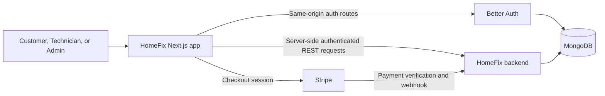

<div align="center">

# 🏠 HomeFix

### Home Services Booking & Management Platform

**Find a service. Book a professional. Get it fixed.**

HomeFix connects customers with home-service technicians and provides dedicated
tools for customers, technicians, and administrators.

[](https://home-fix-cyan.vercel.app)
[](https://github.com/mehrabislam00/HomeFix)
[](https://github.com/mehrabislam00/HomeFix-Backend)

</div>

---

## 📑 Table of Contents

- [Overview](#-overview)
- [Live Site](#-live-site)
- [Features](#-features)
- [Tech Stack](#-tech-stack)
- [Architecture](#-architecture)
- [Project Structure](#-project-structure)
- [Getting Started](#-getting-started)
- [Environment Variables](#-environment-variables)
- [Available Scripts](#-available-scripts)
- [Deployment](#-deployment)
- [Repositories](#-repositories)

---

## 🌟 Overview

HomeFix is a full-stack home-services platform. Customers can discover
services, request bookings, and manage payments. Technicians can manage
services and booking requests, while administrators oversee users, bookings,
service approvals, and transactions.

| 👤 Customer | 🧰 Technician | 🛡️ Admin |
| --- | --- | --- |
| Browse services and view service details | Create and manage services | Manage users |
| Request and track bookings | Review and update booking requests | Review and approve services |
| Manage profile and payment history | Manage profile and payment history | Monitor bookings and transactions |

## 🚀 Live Site

👉 **[home-fix-cyan.vercel.app](https://home-fix-cyan.vercel.app)**

## ✨ Features

<details open>
<summary><b>🔎 Service Discovery</b></summary>

- Browse home services and categories
- View service and technician details
- Explore related and top-rated services

</details>

<details open>
<summary><b>📅 Booking Management</b></summary>

- Submit service booking requests
- View booking details and status
- Manage customer bookings
- Review and update technician requests

</details>

<details open>
<summary><b>👥 Role-Based Dashboards</b></summary>

- Customer dashboard for bookings, profile, and payments
- Technician dashboard for services, requests, profile, and payments
- Admin dashboard for users, bookings, approvals, and transactions

</details>

<details>
<summary><b>💳 Payments and Notifications</b></summary>

- Stripe Checkout for eligible bookings
- Payment history and transaction views
- In-app notification actions

</details>

<details>
<summary><b>🔐 Authentication</b></summary>

- Email and password registration and sign-in
- Google sign-in when configured
- Better Auth session handling
- Role-protected customer, technician, and admin areas

</details>

## 🧰 Tech Stack

| Category | Technologies |
| --- | --- |
| **Framework** | Next.js 16 App Router |
| **UI** | React 19, Base UI, shadcn/ui |
| **Language** | TypeScript |
| **Styling** | Tailwind CSS 4 |
| **Authentication** | Better Auth |
| **Database** | MongoDB |
| **Payments** | Stripe |
| **Charts** | Recharts |
| **Icons and utilities** | Lucide React, date-fns |
| **Frontend hosting** | Vercel |

## 🏗 Architecture



### Frontend

- Next.js App Router provides public pages, authentication routes, and role
  dashboards.
- Server Actions and server-side API clients communicate with the backend.
- Better Auth provides email/password and optional Google authentication.
- Backend requests use `NEXT_PUBLIC_API_BASE_URL`, read only by server-only code.

### Backend

The separate HomeFix backend provides the REST API for service, booking,
profile, admin, payment, and notification operations. See the
[server repository](https://github.com/mehrabislam00/HomeFix-Backend) for its
configuration and deployment instructions.

## 📂 Project Structure

```text
HomeFix/
├── app/
│   ├── (auth)/                 # Login, registration, and admin sign-in
│   ├── (dashboard)/
│   │   ├── customer-dashboard/ # Customer bookings, profile, and payments
│   │   ├── admin-dashboard/    # Users, bookings, approvals, transactions
│   │   └── technician-dashboard/ # Services, requests, profile, payments
│   ├── (site)/                 # Homepage, services, and about page
│   ├── api/auth/               # Better Auth handler
│   ├── api/profile/avatar/     # Profile avatar route
│   └── auth/complete/          # Post-authentication routing
├── components/
│   ├── Admin/
│   ├── Dashboard/
│   ├── Services/
│   ├── Technician/
│   └── ui/                     # Shared UI components
├── lib/
│   ├── Action/                 # Server Actions and data operations
│   ├── auth.ts                 # Better Auth server configuration
│   ├── server-jwt.ts           # Backend access-token handling
│   └── service-booking-api.ts  # Shared backend API client
├── public/                     # Public static assets
├── .env.example                # Environment variable template
├── next.config.ts
└── package.json
```

## ⚡ Getting Started

### Prerequisites

- Node.js 20.19 or later
- npm
- MongoDB credentials
- The HomeFix backend repository
- Google OAuth and Stripe credentials for those integrations

### 1. Clone and install the frontend

```bash
git clone https://github.com/mehrabislam00/HomeFix.git
cd HomeFix
npm ci
```

### 2. Configure the environment

Copy `.env.example` to `.env.local` and replace the example values with your
local credentials. See [Environment Variables](#-environment-variables).

### 3. Start the backend

Clone the [HomeFix backend repository](https://github.com/mehrabislam00/HomeFix-Backend)
and follow its README to configure and run the API. The local frontend default
expects the backend at `http://localhost:5000`.

### 4. Start the frontend

From the frontend repository:

```bash
npm run dev
```

Open **http://localhost:3000**.

## 🔑 Environment Variables

Set these in `.env.local` for development and in the hosting provider's
server-side environment settings for production.

| Variable | Required | Description |
| --- | :---: | --- |
| `BETTER_AUTH_URL` | ✅ | Canonical URL of the HomeFix application |
| `NEXT_PUBLIC_API_BASE_URL` | ✅ | Base URL of the HomeFix backend API; consumed only by server code |
| `MONGODB_URI` | ✅ | MongoDB connection URI |
| `MONGODB_USERNAME` | ✅ | MongoDB username |
| `MONGODB_PASSWORD` | ✅ | MongoDB password |
| `GOOGLE_CLIENT_ID` | Optional | Google OAuth client ID; configure with the secret |
| `GOOGLE_CLIENT_SECRET` | Optional | Google OAuth client secret; configure with the ID |
| `STRIPE_SECRET_KEY` | For payments | Stripe secret key used by the frontend server |
| `HOMEFIX_PAYMENT_API_SECRET` | For signed API requests | Shared API-signing secret; configure the matching backend value |

In production, `BETTER_AUTH_URL` and `NEXT_PUBLIC_API_BASE_URL` must use HTTPS
and non-localhost hosts. Although the existing backend URL variable has a
`NEXT_PUBLIC_` prefix, the application reads it only in server-only modules;
it is never used by client components. The backend also needs its Stripe
webhook configuration; see the backend repository.

> [!IMPORTANT]
>
> - Never commit `.env`, `.env.local`, or production secrets.
> - Do not reuse the development localhost URLs in production.
> - Configure the Google OAuth redirect URL and Stripe webhook for the deployed
>   application/backend.

## 📜 Available Scripts

| Command | Description |
| --- | --- |
| `npm run dev` | Start the development server |
| `npm run build` | Create an optimized production build |
| `npm start` | Start the production server |
| `npm run lint` | Run ESLint |
| `npm run typecheck` | Run TypeScript checks |
| `npm run format` | Format TypeScript and TSX files |

## ☁️ Deployment

The live frontend is hosted on **Vercel**. To deploy:

1. Import the client repository into Vercel.
2. Set the required production environment variables in the Vercel project.
3. Use the deployed frontend URL for `BETTER_AUTH_URL`.
4. Set `NEXT_PUBLIC_API_BASE_URL` to the HTTPS backend URL.
5. Configure Google OAuth and Stripe for the production URLs.
6. Confirm the backend's database access and matching API-signing secret.
7. Deploy and verify authentication, API access, and payment flows.

For another Node.js host, use:

```bash
npm ci
npm run build
npm start
```

## 🔗 Repositories

| Project | Link |
| --- | --- |
| 🌐 Live Site | [home-fix-cyan.vercel.app](https://home-fix-cyan.vercel.app) |
| 💻 Client | [mehrabislam00/HomeFix](https://github.com/mehrabislam00/HomeFix) |
| ⚙️ Server | [mehrabislam00/HomeFix-Backend](https://github.com/mehrabislam00/HomeFix-Backend) |

---

<div align="center">

**HomeFix — Home services, made simpler.**

</div>
